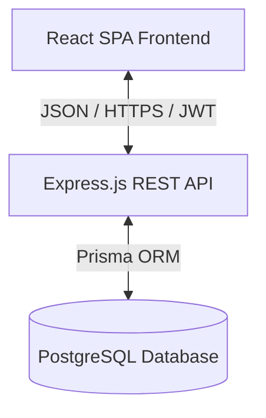
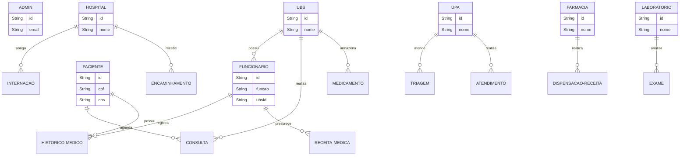
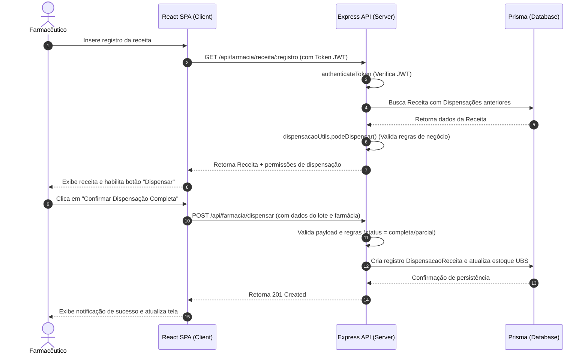

# 🏛️ Arquitetura do Sistema de Saúde Integrado (Sisc Saúde)

O **Sistema de Saúde Integrado (Sisc Saúde)** é uma plataforma voltada para a gestão e integração de serviços de saúde pública e privada. Ela centraliza a comunicação entre diferentes entidades e perfis do ecossistema de saúde (médicos, hospitais, farmácias, laboratórios, pacientes e administradores).

Abaixo está o detalhamento completo da arquitetura do projeto.

---

## 🛠️ 1. Stack Tecnológica

O sistema utiliza a clássica arquitetura de **Single Page Application (SPA)** no frontend comunicando-se com uma **REST API** no backend (arquitetura desacoplada).



### Frontend
- **React (v18)**: Biblioteca principal para construção de interfaces SPA.
- **TypeScript**: Tipagem estática para robustez do código.
- **Vite**: Ferramenta de build e servidor de desenvolvimento ultra-rápido.
- **TailwindCSS & PostCSS**: Framework utilitário de CSS para estilizações responsivas.
- **React Query (React Query v3)**: Gerenciamento e sincronização de estado de servidor (caching, invalidação de consultas).
- **React Router Dom (v6)**: Gerenciador de rotas e rotas protegidas por papéis (*roles*).
- **Axios**: Cliente HTTP para requisições com interceptores de autenticação (JWT).
- **Framer Motion**: Animações fluidas na interface.
- **jsPDF & html2canvas**: Geração de documentos PDF (receitas e atestados) no lado do cliente.

### Backend
- **Node.js**: Ambiente de execução Javascript no servidor.
- **Express**: Framework web minimalista para construção da API REST.
- **Prisma ORM**: Mapeador objeto-relacional para modelagem e migração de banco de dados.
- **JWT (jsonwebtoken)**: Autenticação baseada em tokens com tempo de expiração.
- **Bcryptjs**: Criptografia de senhas com algoritmo de hash Blowfish.
- **Multer**: Middleware para upload de arquivos (exame e laudos em formato PDF).
- **Helmet**: Middleware de segurança HTTP para configurar cabeçalhos adequados.
- **Express Rate Limit**: Proteção contra ataques de negação de serviço (DoS) e força bruta.

---

## 🗄️ 2. Arquitetura de Banco de Dados (Prisma Schema)

O banco de dados é estruturado de forma relacional utilizando **PostgreSQL**. Ele se organiza em torno da entidade principal **Paciente**, que atua como o ponto de união para todo o prontuário de saúde, e do modelo de **Atores do Sistema** que geram esses registros.

### Principais Entidades e Relacionamentos



### Detalhamento das Entidades:
1. **Administração Global (`Admin`)**: CRUD e controle total sobre a criação das instituições de saúde (`UBS`, `Upa`, `Hospital`, `Farmacia`, `Laboratorio`).
2. **Unidade Básica de Saúde (`UBS`)**: Ponto de atendimento primário. Gerencia médicos/funcionários, campanhas de vacinação, agendamentos e estoques de medicamentos.
3. **Hospital (`Hospital`)**: Focado em média/alta complexidade. Gerencia internações, cirurgias, exames internos e altas.
4. **Pronto Atendimento (`Upa`)**: Focado em urgências e emergências. Possui triagem de risco de Manchester, atendimentos de emergência rápida e direciona encaminhamentos para os Hospitais.
5. **Profissionais de Saúde (`Funcionario`)**: Vinculados a uma UBS. Atuam gerando prontuários (`HistoricoMedico`), prescrições (`ReceitaMedica`) e atestados (`AtestadoMedico`).
6. **Farmácias (`Farmacia`)**: Validam receitas digitais e realizam dispensações totais ou parciais dos medicamentos de forma integrada com a rede.
7. **Laboratórios (`Laboratorio`)**: Realizam exames e anexam os resultados diretamente no prontuário digital do paciente.

---

## 🖥️ 3. Arquitetura do Frontend

O frontend segue a filosofia de divisão em componentes atômicos e separação de lógica usando custom hooks e contextos do React.

### Estrutura de Diretórios (`/src`)
- **`/components`**: Componentes de UI modulares e reutilizáveis (botões, tabelas, modais, cabeçalhos, etc.).
- **`/contexts`**: Contextos globais da aplicação. O principal é o `AuthContext.tsx`, que gerencia o estado do usuário logado e distribui o JWT.
- **`/hooks`**: Hooks customizados para isolamento de lógica de negócio e consumo de APIs.
- **`/pages`**: Telas de visualização pública.
- **`/pages/dashboards`**: Portais específicos e restritos para cada tipo de ator do sistema. Cada arquivo é modularizado para a respectiva funcionalidade do ator (ex: `HOSPDashoard.tsx` e `UpaDashboard.tsx`).
- **`/services`**: Configuração de rede. O arquivo `api.ts` configura o Axios com interceptores para enviar o token de forma transparente e realizar logout automático em caso de expiração (erro 401).

### Fluxo de Autenticação e Rotas Protegidas
O acesso às páginas é controlado através de regras baseadas nos papéis dos usuários (*roles*):

```
[ Usuário acessa /admin/* ]
             │
             ▼
   [ ProtectedRoute ]
             │
    Token e Role válidos?
     ├── Sim ──> Renderiza <AdminDashboard />
     └── Não ──> Redireciona para "/" (Home)
```

---

## ⚙️ 4. Arquitetura do Backend

O backend é construído em Node.js com Express, estruturado em camadas para garantir separação de responsabilidades (Routing, Middleware, Controllers, Database Access):

```
       [ Request ]
            │
            ▼
     [ Middleware ]  (Segurança, Rate Limit, Autenticação JWT)
            │
            ▼
       [ Router ]    (Mapeamento de rotas e métodos HTTP)
            │
            ▼
     [ Controller ]  (Validação de payload e regras de negócio)
            │
            ▼
     [ Prisma ORM ]  (Abstração de acesso a dados SQL)
            │
            ▼
      [ Database ]
```

### Separação em Camadas:
1. **`server/index.js`**: Ponto de entrada do aplicativo. Inicializa middlewares globais (CORS, Helmet, Rate Limit, Parser JSON) e monta as rotas da API.
2. **`server/routes`**: Define os endpoints REST. Cada arquivo de rota é mapeado para um recurso específico do sistema (ex: `/api/ubs`, `/api/hospital`).
3. **`server/controllers`**: Contém as funções assíncronas que processam a requisição, executam a lógica de negócios e interagem com o banco de dados via Prisma.
4. **`server/middleware`**: Guarda filtros que interceptam requisições (como validação de tokens e controle de acesso a privilégios).
5. **`server/config`**: Inicializa a conexão com o banco de dados PostgreSQL.

---

## 🛡️ 5. Mecanismos de Segurança Implementados

O sistema foi blindado para evitar incidentes de vazamento de dados médicos em conformidade com as melhores práticas de cibersegurança:

1. **Proteção contra IDOR (Insecure Direct Object Reference)**:
   - A pasta de `/uploads` (exames/laudos) foi removida da exposição estática e pública do Express.
   - O download de documentos médicos sensíveis agora exige autenticação obrigatória via JWT no endpoint `/api/exames/download/:filename`.
2. **Prevenção de Path Traversal**:
   - Sanitização de arquivos com a função `path.basename(filename)` impedindo que requisições maliciosas acessem arquivos confidenciais do sistema operacional (ex: `../../etc/passwd`).
3. **Rate Limiting Inteligente**:
   - Limite global de tráfego para mitigar ataques DoS.
   - Rate limit específico e rígido para rotas de login (máximo de 5 tentativas em 15 minutos), mitigando ataques de força bruta.
4. **Segurança de Criptografia**:
   - Hash seguro com `bcryptjs` para senhas persistidas no banco.
   - Resiliência no carregamento de chaves simétricas: O servidor aborta sua execução imediatamente se a variável de ambiente `JWT_SECRET` não estiver devidamente configurada.
   - Regex rigorosa de força de senha no cadastro: Exige mínimo de 8 caracteres contendo ao menos uma letra maiúscula, uma minúscula e um caractere numérico.

---

## 🔄 6. Fluxo de Comunicação Exemplo (Dispensação de Receita)

Um exemplo prático do funcionamento da arquitetura ponta a ponta quando um farmacêutico atende um paciente:



---

## 📈 Recomendações e Próximos Passos
- **HTTPS Nativo:** Em ambientes produtivos, garantir que a API e o Cliente utilizem exclusivamente conexões HTTPS com HSTS (HTTP Strict Transport Security) habilitado via Helmet.
- **Auditoria de Logs:** Integrar de logs detalhados de auditoria de acessos críticos a dados de pacientes.
